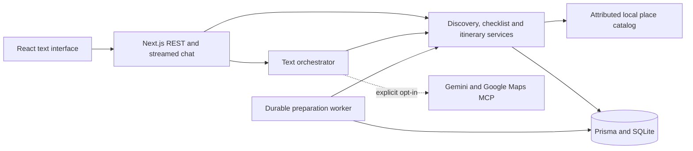

# CityBuddy architecture and migration

## Decision

Retain the Next.js App Router and Prisma over SQLite as a single deployable application. The browser, REST handlers and text conversation entry point already share TypeScript contracts. SQLite supports the local, single-instance workload and lets itinerary changes and job handoffs commit together.

## Baseline audit

| Area | Existing evidence | Migration |
| --- | --- | --- |
| Web and transport | React components, App Router pages, REST handlers, streamed text progress in `lib/client/api.ts` | Keep navigation, chat, guide and checklist. Add an outing workspace and offline map markers. |
| Identity and storage | `lib/server/http.ts` and `repository.ts` assign an HTTP-only browser cookie and store its hash. Prisma stores users, items, sessions and messages. | Keep user ownership and chat turn leases. Add preferences, versioned trips and durable job records through additive SQL. |
| AI and maps | `agent.ts` and `agent-tools.ts` run one Gemini tool loop. `maps.ts`, `location.ts`, `places.ts` and `map-panel.tsx` connect Google providers. | Keep Google adapters behind explicit opt-in. Pass free local requests to deterministic services through the same text endpoint. |
| Location and shopping | Candidate selection resets active geographic context. Checklist writes are scoped, and conversational mutations commit atomically. | Reuse these boundaries for coordinate simulation, shopping skips and preparation invalidation. |
| Planning | No persisted trip model, travel constraints, recommendation service or worker in the baseline schema. | Add those modules to the monolith and preserve existing REST routes. |
| Deployment and checks | Node 22, npm lockfile, Docker Compose, SQLite volume and MCP/model fixture tests. | Keep these entry points and add offline tests. The earlier Docker Hub tag represents its previous build. |

The baseline depends on Gemini for basic chat and on Google for discovery. A hosted-first design would preserve broader search coverage at the cost of provider availability and potential charges. A separate worker service with PostgreSQL and Redis would increase setup and operational work for this single-instance app. The selected design uses an attributed local catalog and SQLite jobs, so routine development neither needs a provider key nor starts cloud resources.

## Migration and compatibility

1. Preserve the cookie identity, existing REST contracts, checklist and text session lifecycle.
2. Add tables for preferences, itineraries, prepared context and jobs. Copy the checklist table in one SQLite transaction to extend its existing status constraint to support skipped items. Keep existing rows, session history and locators.
3. Provide a local catalog, radius and recommendation logic, then use the same planning and state services from REST and text entry points.
4. Prepare context from location and task changes through a SQLite-backed worker. Verify stale revisions, retry and cancellation behavior.
5. Default to local operation. Existing Google credentials stay usable after explicit opt-in. The default local discovery coverage follows the installed catalog. Travel estimates are labeled, and a no-result search remains empty.

No expected cloud spend is required for the local workflow. No metered API calls are needed to verify this refactor. Multi-instance coordination and broader geographic coverage would justify revisiting the database and catalog deployment choices.

Sources for the offline data decision include the [OpenStreetMap license and attribution](https://www.openstreetmap.org/copyright), [regional extracts](https://download.geofabrik.de/asia/india.html), and [public Nominatim limits](https://operations.osmfoundation.org/policies/nominatim/).

## Application boundaries

- `lib/server/outing/catalog.ts` loads the bundled catalog and optional imports. `geo.ts` applies location bias, adaptive search bounds and diversity-aware ranking. `planner.ts` estimates round-trip feasibility using greedy insertion, required stops, shopping categories and meal windows.
- `trips.ts` persists the itinerary, protects edits with optimistic versions and retains visited and skipped stops during replanning. `text.ts` shares the same planning and checklist services with the typed HTTP endpoints.
- `context.ts` fingerprints selected location, preferences, pending items, itinerary revision and dismissals. The worker rechecks the fingerprint before storing results. `jobs.ts` claims SQLite jobs by lease, backs off failures, recovers expired leases and cancels work on superseded context. Prepared data expires after ten minutes.
- `components/outing.tsx` and `components/map-panel.tsx` handle discovery, planning and the simulator. They reuse the existing identity and navigation. The offline plot and catalog require no map tile requests.
- `/api/metrics` reports per-process timings in development. It includes identity lookup, discovery, route estimation, itinerary planning, local and Gemini replies, cache hits and misses, and preparation results and chat use. Counts cover MCP/Places transport requests and Gemini model invocations. Any automatic retries internal to the Gemini SDK are beyond those counts.

Runtime scope is a single long-lived Node.js instance with a SQLite volume. Provider-specific details such as live traffic and opening hours depend on configured sources. Background preparation uses only local data. The existing Google adapters remain available behind explicit metered opt-in.
